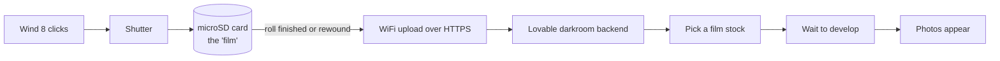
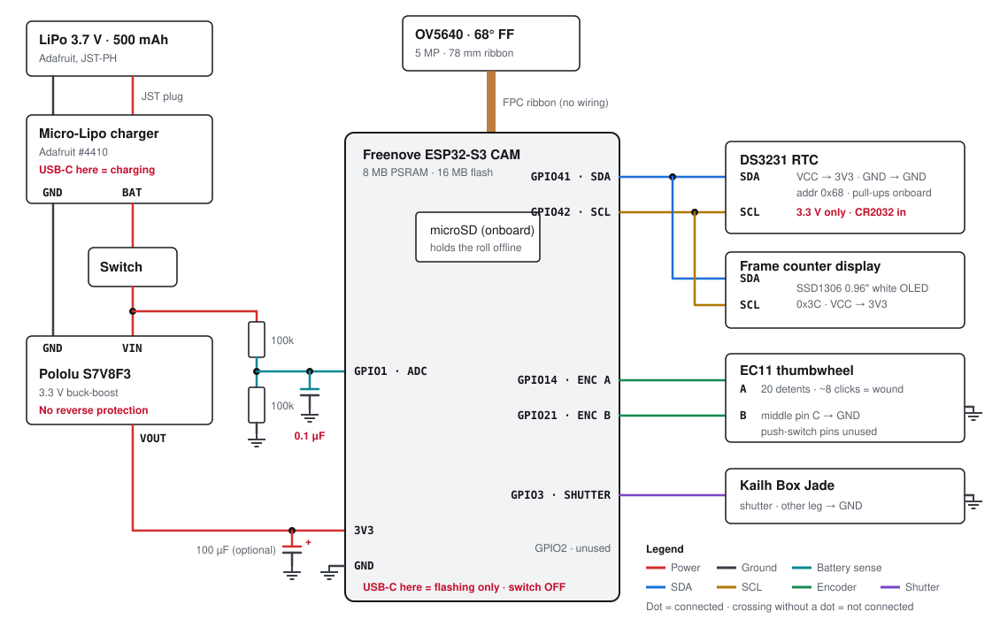

# Figicam

**A 27-exposure camera you build yourself that won't show you your photos.**
You wind it, you shoot, and you wait. When the roll is done it goes to an online darkroom, you pick a film stock, and the photos develop a few minutes later.


---

## Contents

1. [Why this exists](#why-this-exists)
2. [How it works](#how-it-works)
3. [Repo layout](#repo-layout)
4. [Bill of materials](#bill-of-materials)
5. [Electrical](#electrical)
6. [Build guide](#build-guide)
7. [How the camera connects to Lovable](#how-the-camera-connects-to-lovable)
8. [Using it](#using-it)
9. [Troubleshooting](#troubleshooting)
10. [Limits and ideas for v2](#limits-and-ideas-for-v2)

---

## Why this exists

Watch the video here! 

tldr: it's a digital camera that behaves like a film camera:

- **27 exposures per roll.** A film-style counter climbs from 0 to 27.
- **Wind before every shot.** A thumbwheel needs 8 clicks before the shutter unlocks.
- **No screen previews, ever.** The screen only shows the frame counter and battery.
- **A darkroom instead of a camera roll.** Rolls upload to a web darkroom (built with [Lovable](https://lovable.dev)). You choose one film stock per roll, wait for it to develop, then the photos appear.
- **Developing costs nothing.**

It's not quite film, and it isn't exactly digital either.

---

## How it works



- The camera works **fully offline**. Photos are saved to the microSD card as you shoot.
- WiFi is only used to **upload a finished roll** and to **pair** the camera with your darkroom account.
- Film stocks are applied in the darkroom, not on the camera. The original JPEGs are never modified, so a photo can be re-developed in a different stock later.

---

## Repo layout

```
figicam/
├── firmware/          PlatformIO project (ESP32-S3, Arduino framework)
│   ├── platformio.ini
│   ├── include/config.h   ← the only file you need to edit
│   └── src/main.cpp
├── cad/               Enclosure files (STEP + STL). Optional.
├── docs/
│   ├── wiring.svg     Full wiring diagram
│   └── images/        Build photos
└── README.md
```

---

## Bill of materials

Prices are roughly what I paid in Canada (CAD) in late 2026. Total parts per camera come to about **$140 CAD** (~$100 USD), less if you already have a battery, charger and passive components.

### Electronics

| Qty | Part | Notes | ~Price |
|---|---|---|---|
| 1 | **Freenove ESP32-S3-WROOM CAM** (N16R8: 16 MB flash, 8 MB PSRAM) | Has a camera connector and microSD slot onboard. The PSRAM is required for 5 MP photos | C$33 |
| 1–2 | **OV5640 camera module, 24-pin DVP, 68°, fixed focus** | Get the long ribbon (75–78 mm). A second one is a cheap spare | C$11 each |
| 1 | **SSD1306 0.96" OLED, I²C, white** | Get **white**. The "yellow/blue" versions are two-color panels and can't be changed in code | C$10 |
| 1 | **DS3231 RTC module** (ZS-042) + **CR2032** | Timestamps photos while offline | C$15 |
| 1 | **EC11 rotary encoder with detents, 20 detents/rev** | The film-advance thumbwheel. "With detents" matters | C$4 (5-pack C$17) |
| 1 | **Kailh Box Jade** switch | The clicky shutter | C$2 (10-pack C$16) |
| 1 | **3.7 V LiPo, 500 mAh, JST-PH** (e.g. Adafruit #1578) | Bigger is fine if it fits your body | ~C$11 |
| 1 | **Adafruit Micro-Lipo charger, USB-C** (#4410) | Charges the battery through its own USB-C port | ~C$8 |
| 1 | **Pololu S7V8F3** 3.3 V buck-boost regulator | Holds a steady 3.3 V as the LiPo drains from 4.2 V to 3.0 V. Has **no reverse-polarity protection** | C$14 |
| 1 | **SS12D00** (or any SPDT) slide switch | Main power | <C$1 |
| 2 | 100 kΩ resistor | Battery voltage divider | — |
| 1–3 | 0.1 µF ceramic capacitor | Divider smoothing (required), encoder debounce (optional) | — |
| 1 | 100–470 µF electrolytic, ≥6.3 V | Optional. Add it if WiFi uploads cause resets | — |
| — | Perfboard, silicone wire, headers, JST-PH pigtail | | — |

### Enclosure (optional, see [CAD](#step-7-enclosure))

| Qty | Part | Notes |
|---|---|---|
| ~80 g | PETG or PLA | |
| 1 | 1/4"-20 brass heat-set insert (8 × 8 mm) | Tripod mount |
| ~8 | M2/M3 heat-set inserts + screws | Lets you open the body |

### Tools

Soldering iron (plus a heat-set insert tip), multimeter with continuity mode, flush cutters, wire strippers, 3D printer (or a print service), a USB-C **data** cable, and a computer with [VS Code](https://code.visualstudio.com/) or [Cursor](https://cursor.com) plus the **PlatformIO IDE** extension.

---

## Electrical



### Pin map

| ESP32-S3 pin | Connects to | Notes |
|---|---|---|
| **3V3** | Pololu VOUT, DS3231 VCC, OLED VCC | Optional 100 µF from 3V3 to GND (long leg to 3V3) |
| **GND** | Everything's ground | One common ground strip |
| **GPIO1** | Battery divider midpoint | ADC1, so it works with WiFi on. 4.2 V battery reads as 2.1 V |
| **GPIO41** | SDA, shared by DS3231 + OLED | The DS3231 board's pull-ups cover the bus |
| **GPIO42** | SCL, shared by DS3231 + OLED | |
| **GPIO14** | Encoder A | Internal pull-up |
| **GPIO21** | Encoder B | Internal pull-up. Encoder middle pin **C → GND** |
| **GPIO3** | Shutter switch | Other leg → GND. Internal pull-up, reads LOW when pressed |
| Camera FPC | OV5640 ribbon | No wiring, just the ribbon connector |

**Don't use:** 4–13 and 15–18 (camera), 38–40 (SD card), 35–37 (PSRAM), 19/20 (USB), 43/44 (serial), 0/45/46 (boot strapping), 48 (onboard LED).

### Power path

```
LiPo ─JST─► Micro-Lipo charger ─BAT─► switch (middle pin) ─outer pin─► Pololu VIN
                                 └GND─────────────────────────────────► Pololu GND ──► ESP32 GND
                                                                         Pololu VOUT ─► ESP32 3V3
```

### Battery divider

```
Battery + (after the switch)
      │
   [100k]
      │
      ●──────────────── GPIO1
      │         │
   [100k]    [0.1 µF]      ← cap in PARALLEL with the bottom resistor
      │         │
      ●─────────┘
      │
     GND
```

> [!WARNING]
> - **Never power the board from USB and the battery at the same time.** The board's USB and the Pololu both drive 3V3. Turn the power switch **off** before plugging in USB to flash.
> - **Check battery polarity before connecting.** The Pololu dies instantly if it's reversed.
> - **Run the DS3231 at 3.3 V only.** Its charging circuit can overcharge a normal CR2032 at 5 V.
> - **Don't put the 0.1 µF cap in series** with the divider. It blocks DC and pushes GPIO1 to full battery voltage.

---

## Build guide

This assumes you're comfortable soldering, reading a pinout and using a multimeter. Build and test in this order: **firmware on bare USB first, then add parts one at a time, power section last.** Every step ends with a check.

### Step 1: Prepare the microSD card

The kit's 1 GB card is usually FAT32 already. If not, format it as **FAT32** (macOS Disk Utility: *MS-DOS (FAT)*, *Master Boot Record*). Insert it into the board's onboard slot, gold contacts toward the board.

### Step 2: Flash the firmware (USB only, nothing else wired)

1. Install VS Code or Cursor, then the **PlatformIO IDE** extension. Reload when it asks.
2. **File → Open Folder → `firmware/`**, the folder that contains `platformio.ini`. The first open downloads the ESP32 toolchain, which takes a few minutes.
3. Edit `include/config.h`:
   - `API_BASE`: your darkroom's API URL (see [Step 8](#step-8-set-up-the-darkroom)).
   - `CAMERA_ID`: **make it unique**, e.g. `figicam-yourname`. Two cameras can't share an ID.
   - `API_KEY`: generate one with `openssl rand -hex 16` and paste it in. **Never change it after pairing.** The darkroom locks your camera to the first key it sees.
   - `FRAMES_PER_ROLL`: set to `3` while testing, `27` when you're done.
4. Plug into the board's **UART** USB-C port, the one next to the small **CH343 / WCH** chip.
   - Not sure which port that is? Run `pio device list` and use the port with **VID:PID `1A86:55D3`** ("USB Single Serial"). On macOS it shows up as `/dev/cu.usbmodem…`.
5. Upload and open the monitor:
   ```bash
   pio run -t upload
   pio device monitor -b 115200
   ```
   Press **RST** on the board to see the full boot log.

**☑ Check:** the log shows `=== Figicam v1 ===`, `psram:` around 8 MB, and `sd:1`. The camera, RTC and display will read `0` until they're connected.

- **No port appears:** swap the cable (many USB-C cables only charge) or install the WCH CH343 driver.
- **Stuck at "Connecting…":** hold **BOOT**, tap **RST**, release **BOOT**, and upload again.

### Step 3: Install the OV5640

Power off. Flip up the latch on the board's camera FPC connector, remove the stock camera, slide in the OV5640 ribbon (contacts facing the same way as the stock ribbon), and close the latch.

**☑ Check:** the boot log shows `Camera sensor PID: 0x5640 (OV5640)` and `camera:1`.

### Step 4: Wire the I²C bus (OLED + RTC)

1. Put the **CR2032** in the DS3231.
2. Wire both modules in parallel: **VCC → 3V3**, **GND → GND**, **SDA → GPIO41**, **SCL → GPIO42**.
   > Read the OLED's printed pin labels. Some boards are `VCC GND SCL SDA`, others `GND VCC SCL SDA`. Swapping VCC and GND kills the display.

**☑ Check:** the boot log's I²C scan shows `0x3C` (OLED), `0x57` (RTC EEPROM) and `0x68` (RTC), then `rtc:1 lcd:1`. The OLED shows the frame counter.

- If it finds `0x3C` but not `0x68`, the RTC's SDA/SCL are swapped or loose.
- If the OLED shows garbage or is shifted by 2 px, it's an SH1106, not an SSD1306. Change the display constructor in `main.cpp` to `U8G2_SH1106_128X64_NONAME_F_HW_I2C`.

### Step 5: Wire the controls

**Shutter (Kailh Box Jade):** one leg → **GPIO3**, the other → **GND**.

**Thumbwheel (EC11):** on the 3-pin side, **A → GPIO14**, **C (middle) → GND**, **B → GPIO21**. The 2-pin push-switch side stays unconnected. Optionally add 0.1 µF from A to GND and from B to GND if clicks jitter.

**☑ Check:** turning the wheel fills the wind track on screen, and after 8 clicks the counter rolls to the next number. Pressing the shutter before winding flashes "WIND".

- If one detent counts as two clicks (or two as one), change `ENC_STEPS_PER_CLICK` in `config.h` between 4 and 2.
- If the wrong direction counts, set `ENC_REVERSE 1`.

### Step 6: Build the power section

Do this last, on perfboard, with a single ground strip.

1. **LiPo → Micro-Lipo charger** via its JST socket. **Check polarity first:** red is +.
2. **Charger BAT → slide switch middle pin.** Charger GND → ground strip.
3. **Switch outer pin → Pololu VIN.** Use a continuity meter to find which outer pin connects to the middle pin in your chosen ON position. Leave the other outer pin empty.
4. **Pololu GND → ground strip. Pololu VOUT → ESP32 3V3.** Leave Pololu SHDN unconnected (it's pulled high internally).
5. **Battery divider:** from the switched side (Pololu VIN), 100 kΩ → midpoint → 100 kΩ → GND. Midpoint → **GPIO1**. 0.1 µF from the midpoint to GND (in parallel with the bottom resistor).
6. *(Optional)* 100 µF across 3V3 and GND, close to the board, **long leg (+) to 3V3**.

The SS12D00 is rated 0.5 A. The camera averages about 250 mA with short WiFi peaks, so use short, solid joints.

**☑ Check:** unplug USB and flip the switch on. The board boots on battery and the battery icon shows a level instead of a lightning bolt. Charge through the **Micro-Lipo's** USB-C, never the board's.

### Step 7: Enclosure

The `cad/` folder has my body as STEP and STL files. It's optional: design your own if you want a different shape. Key dimensions if you design your own:

| Part | Dimension |
|---|---|
| OLED module | ~27 × 27 mm. The visible area is ~22 × 11 mm, off-center toward the pins. Measure yours |
| Kailh Box Jade | 14.0 × 14.0 mm square cutout in a 1.5 mm plate (the switch clips in) |
| EC11 | 7 mm hole for the threaded bushing. The printed wheel pokes through a slot in the top plate |
| 1/4"-20 insert | ~7.6 mm hole (check your insert's spec) |
| Frame finder | 32 × 24 mm front window, 30 mm in front of a 3 mm rear peephole (matches the 68° lens) |
| 500 mAh LiPo | ~29 × 36 × 5 mm |
| ESP32 board, camera module | Measure with calipers |

Print settings that worked for me: 0.2 mm layers, 3 walls, 15–20% infill, front and back halves printed flat. Install heat-set inserts with the iron at your filament's print temperature.

**☑ Check:** before closing the body, run through a full roll with `FRAMES_PER_ROLL 3`.

### Step 8: Set up the darkroom

Pick one:

- **Option A: use the hosted darkroom (fastest).**
  Site: <!-- TODO: confirm published URL --> https://project--72c6fdf9-c335-4574-89fe-bfa19ac9a329.lovable.app
  In `config.h`: `API_BASE "https://project--72c6fdf9-c335-4574-89fe-bfa19ac9a329.lovable.app/api/public"`
  Sign in with your email and you're ready to pair. Remember your `CAMERA_ID` must be unique.

- **Option B: remix your own darkroom on Lovable.**
  Open <!-- TODO: add your Lovable remix link --> **[the Figicam darkroom remix link](#)** and remix it. You get your own copy with its own backend, so your photos live in your account. Publish it, then set `API_BASE` to `https://<your-published-domain>/api/public`. While testing, set the `DEVELOP_MINUTES` secret to `1` so you don't wait two hours.

### Step 9: Connect to WiFi and pair

1. Make sure the camera **isn't wound** (the wind track is empty; take a photo first if it is).
2. **Hold the shutter about 8 seconds** until the screen says **"wifi setup"** and shows **`Figicam-XXXX`**.
3. On your phone, join **Figicam-XXXX** (no password). A setup page pops up. If it doesn't, open **`http://192.168.4.1`** in a browser.
4. Tap **Configure WiFi**, pick your network, enter the password, tap **Save**.
   - The network must be **2.4 GHz** and have **no login page** (café, hotel and campus WiFi like eduroam won't work).
   - With an iPhone hotspot, turn on **Maximize Compatibility** and keep the Personal Hotspot screen open.
5. The camera connects and shows a **6-digit code**. On the darkroom site, open **Camera → Connect your camera** and type it in.
6. The camera shows **"paired"** and goes back to the counter.

Repeat steps 2–4 any time to add another network. The camera remembers several and joins the strongest one in range. Pairing survives reboots, site reloads and new networks.

**☑ Check:** shoot a 3-frame test roll (see [Using it](#using-it)). It uploads and shows up in the darkroom under **In the tray**.

---

## How the camera connects to Lovable

**The ESP32 never talks to your phone or browser. It uploads each photo over HTTPS straight to the darkroom's backend (Lovable Cloud), signed with its own camera ID and key, and the website just reads from that backend.** That's why any number of devices can have the site open at once, and why reloading the site never "disconnects" the camera: the camera belongs to your **account**, not to a device.

The camera only goes online to pair or to upload a finished roll. Everything else is offline.

| Endpoint | Method | Used for |
|---|---|---|
| `/camera-pair-start` | POST | Registers the camera on first contact and returns a 6-digit pairing code |
| `/camera-status` | GET | The camera checks whether it's been claimed by an account |
| `/upload-frame` | POST | One raw JPEG per request. Headers: `x-roll-id`, `x-frame`, `x-captured-at`, `x-frames-total`. Retries never duplicate |
| `/upload-frame` + `x-roll-complete: 1` | POST | Closes the roll so it appears in the darkroom |

Every camera request carries `x-camera-id` and `x-api-key`. Photos are stored in a **private** bucket and are only served once a roll has finished developing.

---

## Using it

| Action | When | What happens |
|---|---|---|
| **Turn the thumbwheel** | After every shot | 8 clicks fill the wind track and roll the counter to the next frame. Backwards turns are ignored |
| **Tap the shutter** | Wound | Takes the photo: the screen blinks, shows "processing…", and the photo saves to SD |
| **Tap the shutter** | Not wound | Flashes "WIND" |
| **Hold 3 s, release** | Shooting, ≥1 frame shot | "rewind?". Tap again within 4 s to end the roll early and upload what you've shot |
| **Hold 3 s, release** | After "roll sent" | Loads a new roll and wipes the previous one from the SD card |
| **Hold 8 s** | Not wound | WiFi setup + pairing. A tap cancels |

After frame 27 (or a rewind) the camera uploads the roll by itself. With no WiFi it shows "no wifi" and retries every minute. A shutter tap retries right away. **Photos are safe on the SD card until the roll is confirmed uploaded.**

**In the darkroom:** open the roll from **In the tray**, pick **one** film stock, and hit **Develop**. When the timer runs out, the photos hang on the line. You can re-develop a single photo or the whole roll in a different stock later. It replaces the old look, and the original is always kept.

---

## Troubleshooting

| Symptom | Fix |
|---|---|
| No serial port shows up | Use a data cable, try the other USB-C port on the board, or install the WCH CH343 driver |
| Upload hangs at "Connecting…" | Hold BOOT, tap RST, release BOOT, upload again |
| `camera:0` | Reseat the ribbon. Contacts face the same way as the stock camera's |
| Corrupt photos / `NO-EOI` in the log | Lower `CAM_XCLK_HZ` to `16000000` in `config.h` |
| Photos upside down | Uncomment `set_vflip` in `initCamera()` |
| `sd:0` | Reformat the card as FAT32 and reseat it |
| `rtc:0`, but `0x3C` found | RTC SDA/SCL swapped or loose |
| OLED blank or garbled | Check VCC/GND against the printed labels. Garbled or shifted means it's an SH1106 (see Step 4) |
| Display is yellow/blue | Hardware: buy the white version |
| "no wifi" during upload | 2.4 GHz only, no login pages. On an iPhone hotspot, keep the Personal Hotspot screen open and Low Power Mode off |
| Upload returns 401 | `API_KEY` doesn't match what the darkroom registered. Don't change the key after pairing |
| Upload returns 403 / "not paired" | Hold the shutter 8 s and pair again |
| Board resets when uploading on battery | Add the 100 µF cap across 3V3/GND. Check for `Brownout` in the log |
| Roll state stuck after testing | Set `RESET_ROLL_ON_BOOT 1`, flash once, set back to `0` |

---

## Limits and ideas for v2

- **No true RAW.** The OV5640 outputs processed 8-bit JPEGs, so the darkroom's film stocks work well on color and grain but can't recover blown highlights.
- **Battery:** the camera stays awake while on (about 2 hours of on-time on 500 mAh). Switch it off between sessions. Deep sleep with wake-on-wheel is the obvious v2.
- **HTTPS certificates aren't pinned yet** (`setInsecure()`).
- v2 ideas: M12 lens mount for swappable lenses, ESP32-P4 + IMX219 for a better sensor, a custom PCB to shrink the body.

Built by [Izy](https://izyanali.com) in **partnership** with [Lovable](https://lovable.dev).
